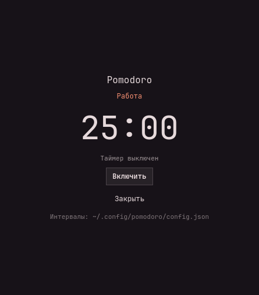

# Pomodoro for Omarchy

[Русский](README.md) · [MIT License](LICENSE)



A work and rest timer for the Omarchy panel. Start a 25-minute work interval, then start each 5-minute rest or next work interval manually. Colors, fonts, corners, motion preferences, and language follow Omarchy. English and Russian translations are included; other languages fall back to English.

## Install

```bash
omarchy plugin add https://github.com/Maximilyanus29/omarchy-pomodoro.git --enable
```

Requirements: Omarchy with the current Quickshell shell interfaces and system Python 3. Tested on Omarchy 4.5.0 and Python 3.14. No build step, pip packages, credentials, network access, or elevated privileges are needed. The separate `install.py` is an optional development installer, not a prerequisite for the standard Omarchy command.

The widget is placed beside the clock and remains off until you enable the timer. Click its icon to open the controls:

- **Enable** starts the first work interval immediately.
- **Pause / Resume** preserves the remaining time.
- **Reset** restores the full duration of the current phase and pauses it.
- **Turn off** ends the cycle; enabling it again starts a fresh work interval.

When a phase ends, a small dialog shows the next interval. **Start** begins that interval; **Close** or Escape dismisses the dialog and leaves the next interval waiting. Reopen it through the panel widget. Tab moves between buttons; Enter or Space activates the focused button. There is no alarm sound.

Linux monotonic time excludes suspend and ignores wall-clock changes. An interval that was running continues after resume. Screen locking alone does not pause the clock. All monitors share one timer; the end-of-phase dialog appears on the focused monitor. State survives a shell or service restart within the same Hyprland session. A new login starts with the timer off.

## Configure

Defaults are 25/5, including when no configuration file exists. To change them, create or edit `~/.config/pomodoro/config.json` (or `$XDG_CONFIG_HOME/pomodoro/config.json`):

```json
{
  "work_minutes": 25,
  "break_minutes": 5
}
```

Durations must be whole minutes from 1 to 10080. Changes are read once per second and apply to the next phase, reset, or fresh enable, preserving the current interval. Invalid configuration shows an error and retains the last valid values, or defaults on first launch.

The plugin runs its own local `python3 timer.py` helper, reads the configuration file, and atomically writes session state under `$XDG_RUNTIME_DIR/max.pomodoro/`. It does not change the durations file or desktop configuration at runtime. The optional development installer changes `shell.json` only when explicitly run and backs it up before adding the plugin entries.

## Update and remove

```bash
omarchy plugin update max.pomodoro
```

If Omarchy retains old QML components after an update, run `omarchy restart shell`; the timer state is restored. Omarchy refuses this command while the session is locked.

Turn off the timer before removing the plugin:

```bash
omarchy plugin remove max.pomodoro
```

Your durations file is retained. For manual removal, remove `max.pomodoro` entries from `plugins` and `bar.layout` in `~/.config/omarchy/shell.json`, then delete the plugin directory. Leave unrelated settings intact.

## Development and verification

```bash
omarchy plugin validate .
python3 -m unittest discover -s tests -v
python3 tests/check_ui.py
```

The UI check drives real QML mouse and keyboard events offscreen and tests a live Russian-to-English switch in a temporary configuration. It does not change your desktop language. The Python suite has 15 tests covering the clock and installer. A complete 1/1 cycle and state restoration after a real service restart were also checked on the desktop. Real suspend and multiple physical monitors have not been tested separately.

IPC is available through `omarchy-shell max.pomodoro status`, `enable`, `start`, `pause`, `reset`, `disable`, and `dismiss`. The helper exchanges JSON lines over stdin/stdout and sends diagnostics to stderr. Runtime helper failures are shown in the controls with a retry button.

## License

The code and included preview screenshot are distributed under the [MIT License](LICENSE). The preview contains only the plugin's test interface.
