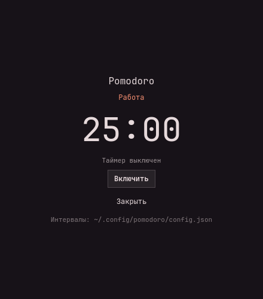

# Pomodoro для Omarchy

[English](README.en.md) · [MIT License](LICENSE)



Виджет панели с рабочими интервалами и отдыхом. Оформление и язык следуют текущим настройкам Omarchy. Нужны установленная Omarchy с Quickshell и Python 3 из системы; дополнительные пакеты не требуются.

## Управление

Нажмите на значок таймера рядом с часами. «Включить» немедленно начинает первый рабочий интервал. Во время отсчёта доступны «Пауза», «Продолжить», «Сброс» и «Выключить».

После работы появляется небольшое окно с полным временем отдыха. Нажмите «Начать», когда будете готовы. После отдыха так же запускается работа. Закрытие окна не запускает следующий этап: он остаётся доступен через виджет. «Сброс» возвращает полную длительность текущего этапа и ставит его на паузу. «Выключить» завершает цикл; следующее включение начинает работу заново.

| Действие | Управление |
| --- | --- |
| Открыть или скрыть управление | Нажатие на виджет |
| Переход между кнопками | Tab / Shift+Tab |
| Нажать выбранную кнопку | Enter / Space |
| Закрыть окно | Escape |

Монотонные часы Linux не учитывают сон ноутбука и не зависят от перевода системного времени. После пробуждения работающий отсчёт продолжается. Блокировка экрана сама по себе не останавливает время.

Сервис общий для всех мониторов; окно завершения показывается на активном мониторе. Состояние сохраняется при перезагрузке панели в `$XDG_RUNTIME_DIR/max.pomodoro/`. При новом входе в Hyprland таймер выключен. Звука нет.

## Конфигурация

`~/.config/pomodoro/config.json` (или `$XDG_CONFIG_HOME/pomodoro/config.json`):

```json
{
  "work_minutes": 25,
  "break_minutes": 5
}
```

Значения — целые минуты от 1 до 10080 (неделя). Файл перечитывается каждую секунду. Изменения действуют для следующего этапа, сброса или нового включения, не меняя текущий остаток. Если файл отсутствует, используются 25/5; если повреждён, показывается ошибка и сохраняются последние корректные значения (либо 25/5 при первом запуске).

## Установка и проверка

Рекомендуемый способ — штатная команда Omarchy; отдельный установщик не нужен:

```bash
omarchy plugin add https://github.com/Maximilyanus29/omarchy-pomodoro.git --enable
```

Плагин появится рядом с часами и будет выключен до нажатия «Включить». Без файла конфигурации работают значения 25/5; чтобы изменить их, создайте `~/.config/pomodoro/config.json` по примеру выше. Нужны Omarchy с интерфейсами Quickshell текущей версии и системный Python 3 (проверено на Omarchy 4.5.0 и Python 3.14). Сетевые запросы, API-ключи, повышенные права, сборка и внешние Python-пакеты не используются. Плагин запускает локальный процесс `python3 timer.py`, читает файл интервалов и сохраняет только состояние текущей сессии.

Обновление установленного через Omarchy плагина:

```bash
omarchy plugin update max.pomodoro
```

Альтернативный способ для локальной разработки (установщик добавляет записи в `shell.json` и сохраняет его резервную копию):

```bash
git clone https://github.com/Maximilyanus29/omarchy-pomodoro.git
cd omarchy-pomodoro
python3 install.py
omarchy-shell shell rescanPlugins
```

Распакуйте архив в отдельный каталог и выполните `python3 install.py`. Установщик копирует плагин в пользовательский каталог Omarchy, добавляет его в `plugins` и `bar.layout.centerBegin` файла `shell.json`, не удаляя другие элементы. Перед изменением настроек создаётся резервная копия `shell.json.before-pomodoro-*`. Повторная установка не дублирует виджет и сохраняет интервалы пользователя. Для обнаружения нового плагина выполните `omarchy-shell shell rescanPlugins`.

При обновлении QML работающая оболочка может сохранить старые компоненты в кеше. В таком случае выполните `omarchy restart shell`; состояние таймера восстановится. Команда сама отказывается перезапускать оболочку при активном экране блокировки.

Проверка логики и установки: `python3 -m unittest discover -s tests -v` из каталога плагина. Проверка настоящих QML-кнопок мышью и клавиатурой, а также переключения ru → en: `python3 tests/check_ui.py`. Она работает offscreen во временном окружении и не меняет язык рабочего стола.

Через терминал доступны команды `omarchy-shell max.pomodoro status`, `enable`, `start`, `pause`, `reset`, `disable`, `dismiss`. Команды отправляются одному сервису; `status` возвращает JSON. Процесс `timer.py` принимает строки JSON `{"action":"pause"}` в stdin и передаёт снимки состояния в stdout; stderr содержит диагностику. При недоступности сервиса в управлении появляется ошибка и кнопка повторного запуска.

## Удаление

Сначала нажмите «Выключить», затем выполните:

```bash
omarchy plugin remove max.pomodoro
```

Для ручного удаления уберите записи `max.pomodoro` из `plugins` и всех секций `bar.layout` в `~/.config/omarchy/shell.json`, затем каталог `~/.config/omarchy/plugins/max.pomodoro/`. Файл интервалов можно оставить. Остальные настройки Omarchy менять не требуется.

## Лицензия и проверенные сценарии

Код и приложенный скриншот распространяются по [MIT License](LICENSE). Скриншот показывает только тестовый интерфейс плагина.

Проверены 15 тестов логики и установки, настоящие QML-кнопки мышью и клавиатурой, переключение языка ru → en, полный цикл на интервалах 1/1 и сохранение остатка после перезапуска сервиса. Реальный сон ноутбука и несколько физических мониторов отдельно не проверялись.
